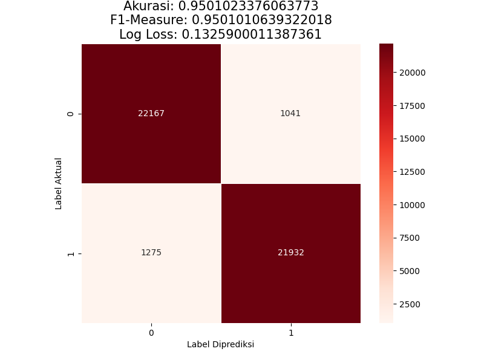
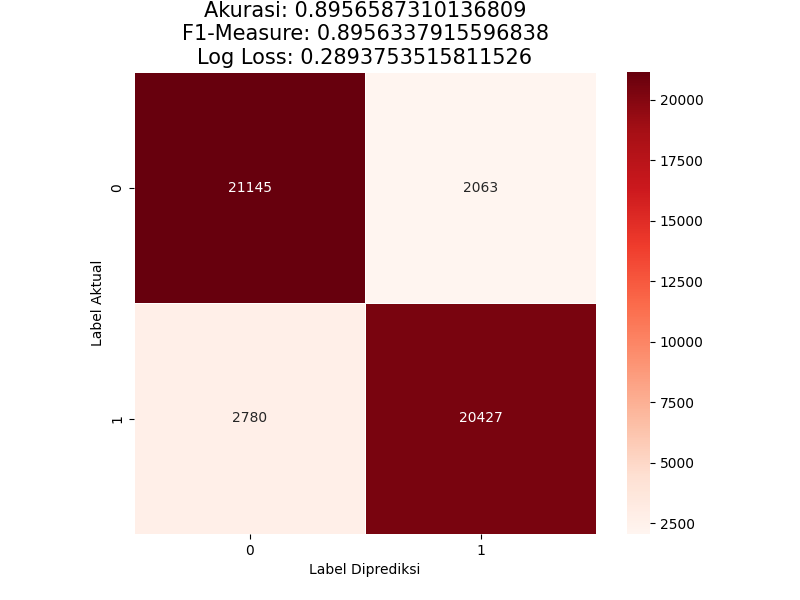
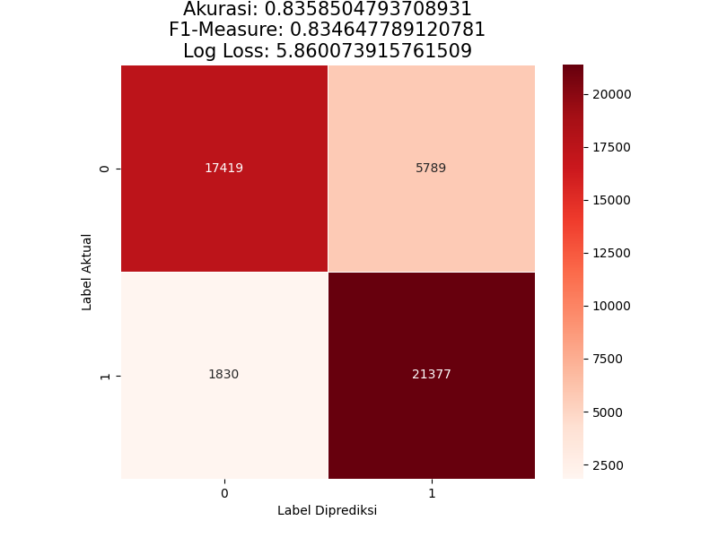

# Suicide Text Detection

Binary text classification (`suicide` / `non-suicide`) of Reddit posts using TF-IDF features and classic ML models.
Team: **The Untouchaballs** — Data Royale. Full report: [`The Untouchaballs - Data Royale.docx.pdf`](The%20Untouchaballs%20-%20Data%20Royale.docx.pdf).

> This is a research/competition project, not a clinical tool. If you or someone you know is struggling, please contact a local crisis line (Indonesia: 119 ext. 8).

## Dataset

[Suicide and Depression Detection — Kaggle](https://www.kaggle.com/datasets/nikhileswarkomati/suicide-watch) (`Suicide_Detection.csv`)

- 232,074 posts, perfectly balanced: 116,037 `suicide` / 116,037 `non-suicide`
- No null or duplicate rows

The dataset is not included in this repo (163 MB). Download it into `dataset/`:

```
kaggle datasets download -d nikhileswarkomati/suicide-watch
```

## Pipeline

Run the notebooks in this order:

| # | Notebook | What it does | Output |
|---|----------|--------------|--------|
| 1 | [`preprocess.ipynb`](preprocess.ipynb) | Lowercase → remove punctuation → remove stopwords → tokenize → lemmatize (NLTK) | `dataset/processed.csv` |
| 2 | [`classifier.ipynb`](classifier.ipynb) | Char-level TF-IDF (1–3 grams, 5000 features), 80/20 stratified split, trains RF / LightGBM / Naive Bayes | `model/*.pickle`, `public/confusion_matrix_*.png` |
| 3 | [`eda.ipynb`](eda.ipynb) | Class distribution, word frequency, wordclouds, text length, polarity, bigrams | plots (inline) |

## Results

Test set: 46,415 posts.

| Model | Accuracy | F1 (weighted) | Model file |
|-------|---------:|--------------:|------------|
| **LightGBM** (lr 0.05, 1000 trees) | **0.95** | **0.95** | `model/lgbm.pickle` (3.8 MB) |
| Random Forest (100 trees, entropy) | 0.90 | 0.90 | not distributed (226 MB) |
| Gaussian Naive Bayes | 0.84 | 0.83 | `model/nb.pickle` |

| LightGBM | Random Forest | Naive Bayes |
|---|---|---|
|  |  |  |

## EDA highlights

- Most frequent bigrams in suicidal posts: *feel like*, *dont know*, *dont want*, *want die*, *im tired*, *im scared*.
- ~7,150 posts contain URLs; mentions, hashtags and subreddit/user tags are rare.

## Models

`model/tfidf.pickle`, `model/lgbm.pickle`, `model/nb.pickle` are included.
`rf.pickle` (226 MB) is not distributed; regenerate it with `classifier.ipynb`.

## Web app

[`app.py`](app.py) is a Streamlit demo using the LightGBM model.

```
pip install -r requirements.txt
streamlit run app.py
```

Deploy on [Streamlit Community Cloud](https://share.streamlit.io): New app → this repo → main file `app.py` → Advanced settings → Python 3.12.
`requirements.txt` pins scikit-learn 1.3.2 / LightGBM 4.1.0 — the versions the pickles were trained with.

Quick prediction with the best model (same steps as the *Testing* section of `classifier.ipynb`):

```python
import pickle, nltk

model = pickle.load(open("model/lgbm.pickle", "rb"))
tfidf = pickle.load(open("model/tfidf.pickle", "rb"))
stop_words = nltk.corpus.stopwords.words("english")
lemmer = nltk.stem.WordNetLemmatizer()

def predict(text):
    words = [w for w in text.lower().split() if w not in stop_words]
    vec = tfidf.transform([" ".join(lemmer.lemmatize(w) for w in words)]).toarray()
    return model.predict(vec)[0]

predict("I am just tired of this life, I don't want to live anymore")  # 'suicide'
```

## Requirements

Python 3.9, `pandas numpy scikit-learn lightgbm nltk matplotlib seaborn` (+ `wordcloud textblob keras networkx` for EDA).
NLTK data: `stopwords`, `punkt`, `wordnet`.
